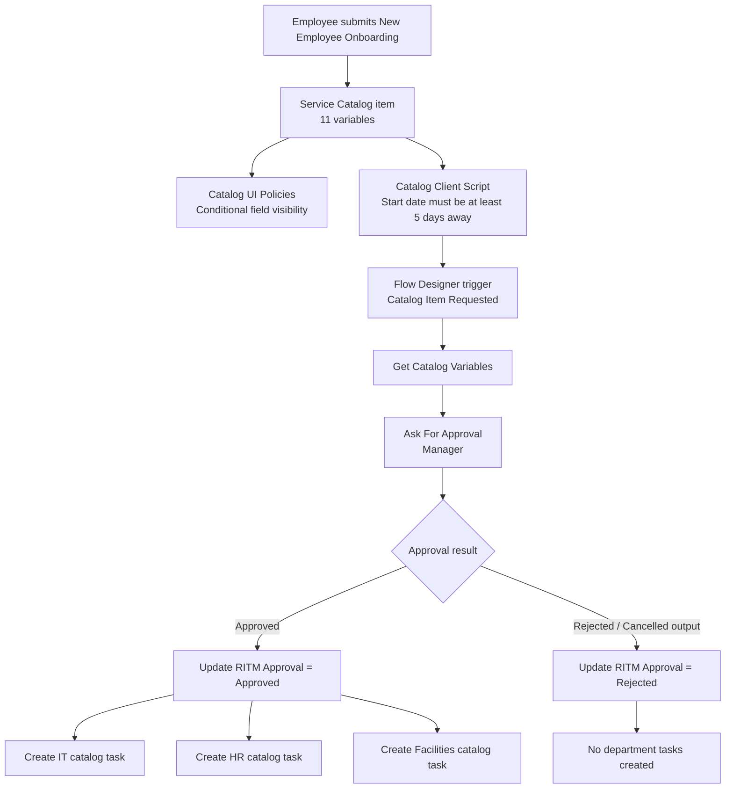

# Architecture — NextGen Employee Onboarding

## Notes

- The flow is triggered automatically when the catalog item is requested.
- The flow uses a manager approval step.
- The approved branch creates the IT, HR, and Facilities tasks sequentially.
- The rejected branch updates the Requested Item approval status to Rejected and does not create those tasks.
- This diagram reflects the tested onboarding scope only. Offboarding and external integrations are not implemented.
